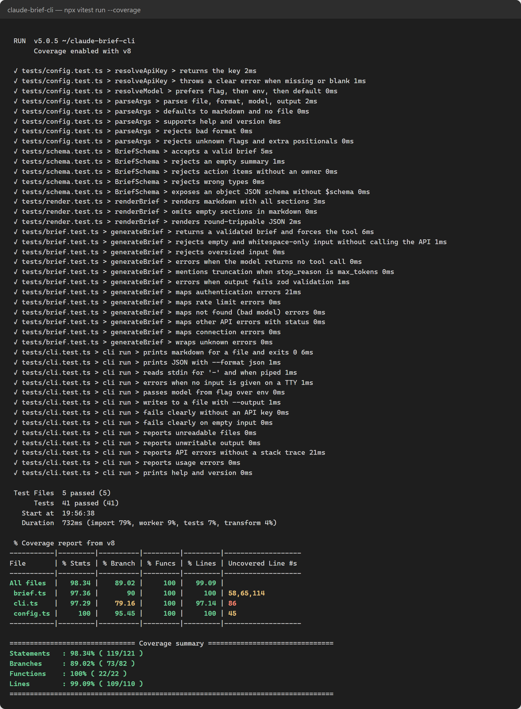

# claude-brief-cli

Turn a messy notes file into a structured brief: summary, decisions, and action items with owners. Output is Markdown or JSON. Built with TypeScript on the [Anthropic SDK](https://github.com/anthropics/anthropic-sdk-typescript).

## Problem

Meeting notes and research dumps are written for the moment, not for the people who weren't there. The useful parts (what was decided, who owns what) are buried in half-sentences. This CLI extracts them, and it is deliberately strict about it: it only reports what the notes say, marks missing owners as `Unassigned`, and raises unresolved ownership as an open question instead of guessing.

## Demo

Input ([`examples/meeting-notes.md`](examples/meeting-notes.md)):

```text
- launch date: we talked about slipping to nov 12 bc QA found the payment retry bug. marcus thinks
  nov 5 is still doable if we cut the referral widget. jo said no way. ended up: going with nov 12...
- who's telling the customers about the delay?? nobody said. probably jo? (jo didn't confirm)
- need someone to book the retro. not discussed who
```

```bash
claude-brief examples/meeting-notes.md
```

Illustrative output (hand-written to show the format; real output varies by model run):

```markdown
# Weekly Sync, Oct 22

## Summary

The team moved the launch to Nov 12 after QA found a payment retry bug. The referral widget stays in scope and the contractor hire is deferred to January.

## Decisions

- Launch on Nov 12; referral widget stays
- Do not hire the contractor this quarter; revisit in January
- Move standup to 9:30 starting Monday

## Action items

- [ ] Redo pricing page copy (owner: Priya, due: Friday)
- [ ] Fix payment retry bug (owner: Marcus, due: 2 days)
- [ ] Notify customers of the delay (owner: Unassigned)
- [ ] Book the retro (owner: Unassigned)

## Open questions

- Who is telling customers about the delay? Jo was suggested but did not confirm.
- Who is booking the retro?
```

## Install

Requires Node.js 20.12+.

```bash
git clone <this repo> && cd claude-brief-cli
npm install
npm run build
npm link            # optional: puts `claude-brief` on your PATH
```

Set your key in the environment (see `.env.example`; the key is read only from `ANTHROPIC_API_KEY`):

```bash
export ANTHROPIC_API_KEY=your-api-key-here
# or load a local .env without any extra dependency:
node --env-file=.env dist/index.js notes.md
```

## Usage

```bash
claude-brief notes.md                       # Markdown to stdout
claude-brief notes.md -f json               # JSON to stdout
cat notes.md | claude-brief -f json | jq .actionItems
claude-brief notes.md -o brief.md           # write to a file
claude-brief notes.md -m claude-haiku-4-5   # override the model
```

| Option | Description |
| --- | --- |
| `-f, --format <markdown\|json>` | Output format (default `markdown`) |
| `-m, --model <id>` | Model id. Precedence: flag, then `BRIEF_MODEL`, then `claude-sonnet-5-5` |
| `-o, --output <path>` | Write to a file instead of stdout |
| `-h`, `-v` | Help, version |

Exit codes: `0` success, `1` runtime failure (missing key, empty input, API error, invalid model output), `2` usage error. Errors are one-line messages on stderr, with no stack traces.

## Design decisions

- **Forced tool call for structured output.** The model must call a `submit_brief` tool (`tool_choice: { type: "tool" }`) whose `input_schema` is generated from the zod schema. This is more reliable than asking for JSON in free text and needs no fence-stripping.
- **zod is the single source of truth, and still validates.** Tool schemas guide the model but do not guarantee conformance, so the tool input is re-validated with zod. Failures name the offending fields.
- **Injected dependencies.** `run()` takes its I/O (fs, stdin, stdout, env, SDK client) as an argument, and `generateBrief()` takes a narrow `BriefClient` type. Tests need no module mocking or real network.
- **Explicit error taxonomy.** SDK errors are mapped to a `BriefError` with a const-object `ErrorCode` (no enums): auth, rate limit, network, unknown model, other API errors, invalid output. Each has an actionable message.
- **Prompt-injection posture.** Notes are wrapped in `<notes>` tags and the system prompt says to treat them as data. Because the only output channel is a schema-validated tool call, the blast radius of a hostile note is a wrong brief, not an action.
- **Strict TypeScript.** `strict`, `noUncheckedIndexedAccess`, `exactOptionalPropertyTypes`; ESLint bans `any`, `interface`, and `enum`.
- **Non-streaming, no retries of its own.** Output is small and must be complete before validation. The SDK already retries transient failures.

## Testing

```bash
npm test                # vitest
npm run test:coverage   # with v8 coverage (thresholds: 80% for lines, functions, branches, statements)
npm run lint && npm run typecheck && npm run build
```

The SDK is never called in tests; a fake `BriefClient` returns canned messages. Covered: schema validation, rendering, argument parsing, key/model resolution, every error mapping (using the SDK's real error classes), empty/oversized input, missing or malformed tool output, and CLI exit codes. CI runs install, lint, typecheck, test, and build on every push and PR.



*Real output of `npx vitest run --coverage --reporter=verbose`, rendered to an image. The only edits are removing Node's colour-forcing warnings and shortening the local project path to `~/`.*

## Limitations

- Input limit is 400k characters per run; there is no chunking.
- Quality depends on the notes. The model is told not to invent owners or decisions, but its output should still be skimmed.
- Plain text and Markdown only (no PDF or audio).

## License

MIT, see [LICENSE](LICENSE).
